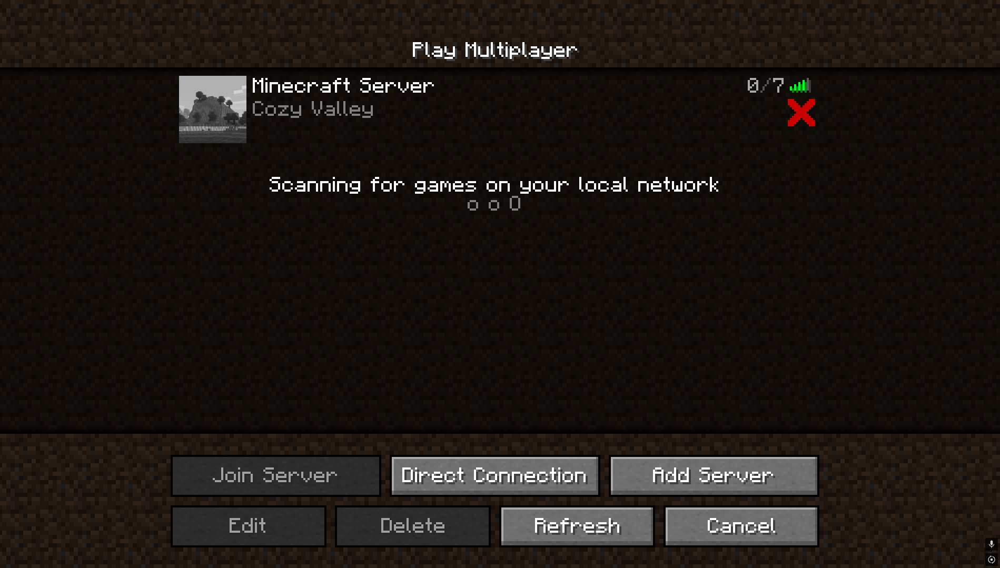
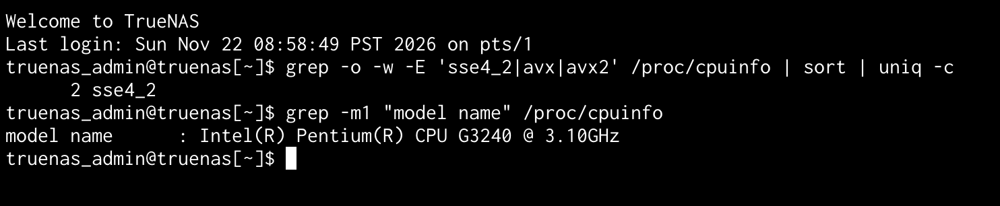
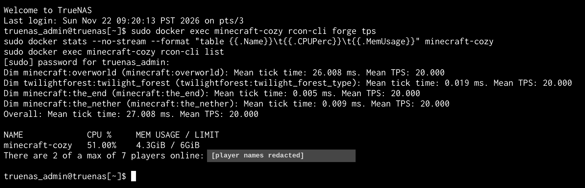
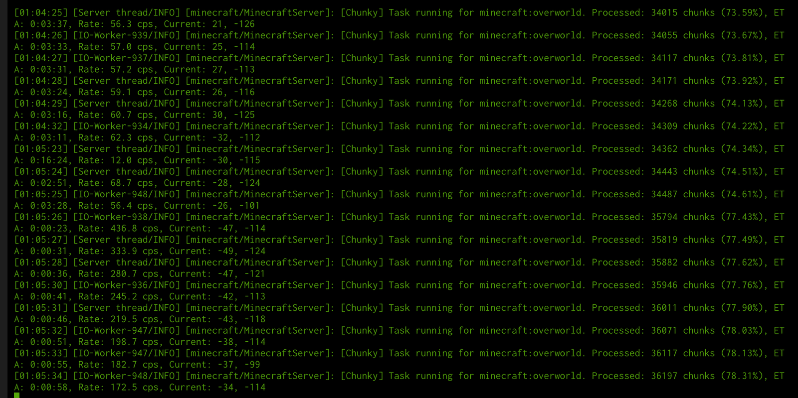
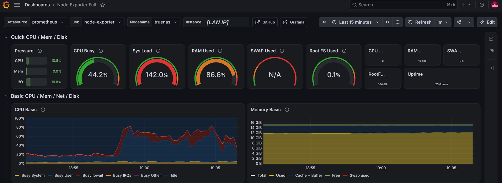

# Game Server — Minecraft ("Cozy Valley")

*Part of the [self-hosted-homelab](../README.md) project.*

---

**Goal:** host a Minecraft server for a small group of friends spread across Germany, Belgium, Finland and Vietnam — up to ~7 players, rarely all online at once — on the same 2-core NAS that already runs Jellyfin, Immich, the arr-stack and the monitoring stack. Same rules as every other module: **Tailscale only, no port forwarding, no public IP.**

The end result is a modded Forge 1.20.1 server ("Cozy Valley", 35 mods) that four friends plus the owner have played on without issues, after going through three different server builds and two network investigations to get there.



*Seen from a TLauncher client. The red ✗ only means the client carries extra client-only mods (minimap, shaders) that the server doesn't run — joining works normally.*

**Deployed while the pool is `DEGRADED`.** The [ZFS disk fault](troubleshooting.md#7-storage-diagnosing-a-faulted-disk-without-touching-hardware) means `tank` is currently running on one disk. Adding a new service under those conditions was a conscious decision: the server's write load is small, it doesn't make the disk situation worse, and the world is protected against everything *except* the last disk failing (see [Still open](#still-open)).

## Feasibility first

| Game | Verdict | Why |
|---|---|---|
| Minecraft (Java) | ✅ Viable | Main loop is single-threaded; RAM need is modest; a small group fits on 2 cores |
| Palworld | ❌ Rejected | Official minimum is 4 cores, and 16 GB+ RAM for the server process alone — this box has 2 cores and 16 GB *shared* with every other service. A hardware ceiling, not a tuning problem |

## Three builds to get here

| # | Build | Outcome |
|---|---|---|
| 1 | **Paper 1.21.10** (vanilla+, plugins only) | Worked after the Java/AVX fix below. Superseded by the modded build and deleted |
| 2 | **Society: Sunlit Valley** (Forge 1.20.1 modpack, ~300 server mods) + Upgrader, Twilight Forest, YUNG's | Ran, but **one player** already used 117% CPU and 5.2–6 GiB RAM. 5–7 players would not fit. Deleted |
| 3 | **Cozy Valley** — a hand-picked Forge 1.20.1 pack, ~10% of Sunlit's size | ✅ Current build |

The Sunlit Valley run was the useful failure: it established a per-player cost on this hardware, which is what justified building a light custom pack instead of picking another big one.

## Architecture

Deployed as a TrueNAS Custom App (Install via YAML) using the [`itzg/minecraft-server`](https://github.com/itzg/docker-minecraft-server) image, on a host-path dataset — the same durable pattern as Prometheus and Immich, never ixVolume.

```yaml
services:
  minecraft-cozy:
    image: itzg/minecraft-server:java17   # NOT :latest — see "The CPU has no AVX"
    container_name: minecraft-cozy
    restart: unless-stopped
    stdin_open: true
    tty: true
    mem_limit: 6g                          # hard ceiling: if it overruns, only Minecraft dies
    ports:
      - "25565:25565"
    environment:
      EULA: "TRUE"
      TYPE: "FORGE"
      VERSION: "1.20.1"
      FORGE_VERSION: "47.4.10"             # pinned to match the client profile exactly
      MEMORY: "4608M"
      UID: "568"
      GID: "568"
      TZ: "Asia/Ho_Chi_Minh"
      ONLINE_MODE: "FALSE"                 # see "Offline mode" below
      ALLOW_FLIGHT: "TRUE"                 # modded movement items otherwise get players kicked
      MAX_PLAYERS: "7"
      VIEW_DISTANCE: "6"
      SIMULATION_DISTANCE: "5"
      OPS: "SShindow"
      MOTD: "Cozy Valley"
    volumes:
      - /mnt/tank/appdata/minecraft-cozy:/data
```

| Piece | Setting |
|---|---|
| Dataset | `tank/appdata/minecraft-cozy`, `chown 568:568` before first deploy |
| Access | Tailscale node sharing of the NAS — each friend accepts the share into their own tailnet |
| Snapshots | Hourly, 3-day retention, non-recursive, no empty snapshots |
| Disconnect timeout | Connectivity mod, `config/connectivity.json` → `disconnectTimeout: 120` (default 60) |
| Pre-generation | Chunky — see [Results](#results) |
| World border | None (a 3,000-block border was tried, then removed because it blocked exploring) |

### The mod list

Mods are **copied from the client's CurseForge profile into the server's `mods/` folder** rather than downloaded by the container from the CurseForge API — see [why](#curseforge-api-rate-limit--and-why-the-server-no-longer-uses-the-api). Client and server are guaranteed identical because they are literally the same files.

| Category | Mods |
|---|---|
| Cozy | Farmer's Delight, Serene Seasons, Handcrafted, Supplementaries, Macaw's Furniture, Macaw's Windows, Friends&Foes |
| Villages | Towns and Towers, Guard Villagers |
| Exploration | The Twilight Forest, Incendium, Nullscape, YUNG's Better Dungeons / Mineshafts / Strongholds / Nether Fortresses / End Island |
| Gamble + QoL | Upgrader items, GraveStone, Waystones, JEI, Jade |
| Performance + stability | ModernFix, FerriteCore, Connectivity, Chunky |
| Server-only | SkinRestorer, WorldEdit (op-only) |
| Libraries (pulled in as dependencies) | Balm, Cristel Lib, Moonlight, Resourceful Lib, YUNG's API, GlitchCore, Cupboard |
| **Client-only** (never copied to the server) | Xaero's Minimap + World Map, Embeddium + Oculus (shaders) |

Rejected along the way: **BetterNether / BetterEnd** (Fabric-only — Incendium / Nullscape are the Forge equivalents), **Create** (too heavy for several players on 2 cores; revisit after the CPU upgrade).

### Client distribution

| Player uses | Gets | Installs via |
|---|---|---|
| CurseForge app (paid account) | CurseForge profile export (`config` + `mods`) | My Modpacks → Import |
| TLauncher | Zip of the raw mod `.jar` files | Forge 1.20.1 in TLauncher, jars into `%appdata%\.minecraft\mods` |

A CurseForge export **does not contain the jars** — it's a manifest of project IDs that the receiving launcher downloads itself. TLauncher can't read it, which is why there are two distribution formats.

### Offline mode — a deliberate trade

One friend plays through TLauncher, which has no Microsoft-account authentication, so `ONLINE_MODE` had to be `FALSE`. Consequences, accepted knowingly:

- **Anyone who can reach the server can join under any name** — including the operator's. The only gate is Tailscale: the server is reachable solely by people the NAS has been shared with.
- **No skins.** In offline mode the server sends no texture data, so every client falls back to one of the nine default skins — even for the player's own character. Fixed server-side with **SkinRestorer** (`/skin set mojang <name>` or `/skin set web classic <png-url>`). TLauncher overrides the skin system with its own, so TLauncher users keep seeing TLauncher skins.
- **Operator rights are kept to one person.** Granting op to a second player was tried and reverted.

## Problems and fixes

### The CPU has no AVX — Java 25 dies with `SIGILL`

**What it looked like:** the `latest` image crash-looped instantly, the JVM dying inside the image's own download helper before Minecraft even started:

```
#  SIGILL (0x4) at pc=0x00007f20e2707f00, pid=48, tid=61
# JRE version: OpenJDK Runtime Environment Temurin-25.0.4.1+1
# Problematic frame:
# v  ~AdapterBlob 0x00007f20e2707f00
```



**What it actually was:** `SIGILL` is an *illegal instruction*. The Pentium G3240 has no AVX/AVX2 at all:

```
$ grep -o -w -E 'sse4_2|avx|avx2' /proc/cpuinfo | sort | uniq -c
      2 sse4_2
```

The Java 25 image ships pre-built code (including an AOT cache used by its helper) compiled on machines that do have AVX.

**What didn't work:** `-Xshare:off` (rejected: conflicts with the image's `-XX:AOTCache`), then `-XX:AOTMode=off -XX:UseAVX=0` — still `SIGILL` in the same frame. Every Java 25 workaround was a guess against an image built for newer CPUs, so the attempts stopped there.

**The fix:** pin an older Java tag — `java21` for Paper 1.21.10, `java17` for Forge 1.20.1. **Minecraft 26.x requires Java 25**, so the latest game versions are blocked on this CPU entirely. The planned i7-4790 (AVX2) removes this limit.

### Memory: the box was fuller than `free` admitted

**What it looked like:** with Sunlit Valley running, `free -h` showed 1.6–2.4 GiB available out of 15 GiB, with **no swap** — one spike from an out-of-memory kill of an arbitrary process (Jellyfin, Immich).

**What it actually was:** three things stacked:

| Consumer | Size | Note |
|---|---|---|
| ZFS ARC | ~3 GiB, allowed to grow to **14.5 GiB** | Counted as "used" by `free`; ZFS gives it back, but gradually |
| qBittorrent | **3.27 GiB** | Torrent file cache while seeding — dropped to ~0.3 GiB once seeding stopped |
| Minecraft JVM | heap + ~1 GiB of non-heap (mod classes, native) | 5 GB heap → ~6 GiB real |

**The fixes:**
- **ARC capped at 3 GiB**, applied live and persisted as a Post-Init command (System → Advanced → Init/Shutdown Scripts):
  ```
  echo 3221225472 > /sys/module/zfs/parameters/zfs_arc_max
  ```
- **`mem_limit` on the container**, so an overrun kills only Minecraft instead of letting the kernel pick a victim.
- **Heap trimmed** to 4.5 GB, and the pack itself made ~10× lighter.

### CurseForge API rate limit — and why the server no longer uses the API

**What it looked like:** the server stuck in a restart loop logging `Access to https://api.curseforge.com is forbidden or rate-limit has been exceeded`, even with a valid API key — and even a single `curl` test returned `403`.

**What it actually was:** each container start looks up every mod by slug (~30 requests). A restart loop multiplies that. Three separate loops triggered it:
1. The literal placeholder `YOUR_KEY` left in the YAML.
2. A wrong slug — Supplementaries' library "Moonlight Lib" is published under its old name, **`selene`**, so `moonlight` returned `Unknown mod`.
3. Retries while the block was already active, which kept it active.

Two smaller traps on the way: **every `$` in a CurseForge key must be written `$$` in compose YAML** (keys look like `$2a$10$...`), and **the key was pasted into a chat transcript several times** and had to be rotated.

**The fixes:**
- `restart: on-failure:3` during setup, so a broken start retries 3 times and stops instead of hammering the API indefinitely.
- **The real fix: remove the API from the server entirely.** Build the profile in the CurseForge app (which resolves versions and dependencies correctly), copy the jars to the NAS over SMB, deploy with plain `TYPE: FORGE`. No key, no slugs, no rate limit, and the client/server mod sets can't drift.

### The owner kept getting kicked — friends didn't

**What it looked like:** the owner, in Germany, was disconnected ~30 seconds after every join (`Timed out` server-side, `Connection reset` client-side), while friends in Belgium and Finland played without a single drop. Server TPS was 20 throughout.

**What it actually was:** packet loss on one specific internet path:

| Test | Loss | Latency |
|---|---|---|
| Owner's PC → `1.1.1.1` (local sanity check) | 0% | 7 ms |
| Owner's PC → NAS, Telekom home line | **6%** | ~241 ms |
| Owner's PC → NAS, O2 network (ALDI TALK hotspot) | **~10%** | ~250 ms |
| NAS → owner's PC (`tailscale ping`, reverse direction) | **~7%** | ~231 ms |
| Friend in Finland → NAS | **0%** | ~266 ms |
| Owner's PC → NAS, **Tailscale routed through a NordVPN Frankfurt server** | **0%** | ~234 ms |

The home network was clean, Tailscale was a direct connection (not a DERP relay), and the NAS wasn't overloaded. The loss sat on the path **German consumer ISPs** (both Telekom and O2) use to reach VNPT. A NordVPN server in a Frankfurt data center — 30 km from the owner, same country — reaches VNPT over different transit and lost nothing. Distance wasn't the problem; whose network carried the packets was. A 300-mod join burst on a 6–10%-loss, 240 ms path stalls TCP long enough to hit the 30-second keep-alive timeout.

**The fix (temporary, client-side):** NordVPN **split tunneling with only `tailscaled.exe` included**. Tailscale's outer WireGuard traffic leaves via the Frankfurt data center; everything else on the PC (browsing, Steam, downloads) is untouched. Confirmed with `tailscale netcheck` showing the NordVPN public IP instead of the home IP, then 60/60 pings and stable play.

<!--  -->
<!--  -->

Also raised Connectivity's `disconnectTimeout` from 60 to 120 s so short stalls freeze instead of kick.

**What didn't work:** using the NAS itself as an exit node — the Minecraft traffic still crosses the same lossy segment to reach it. And `JVM_DD_OPTS: "fml.readTimeout=120"` never reached the JVM; the Connectivity setting was the one that mattered.

This finding very likely also explains the August `iperf3` collapse and the Jellyfin buffering documented in [Media Streaming](media-jellyfin.md) — see [Troubleshooting §9](troubleshooting.md#9-packet-loss-on-one-isps-route--measure-from-a-second-network).

### Smaller ones

| Symptom | Cause | Fix |
|---|---|---|
| `sudo mv /mnt/.../sshindow-private/cozy-mods/*.jar ...` → zsh `no matches found` | The **non-root shell** expands the wildcard before `sudo` runs, and can't read the private SMB dataset | `sudo sh -c 'mv /path/*.jar /dest/'` — let root expand it |
| `rcon-cli worldborder center 288 -320` failed with `unknown shorthand flag` | `rcon-cli` parsed `-320` as its own option | `rcon-cli -- worldborder center 288 -320` |
| Client crash: Chunky + `NoClassDefFoundError: software/bernie/geckolib/...` | A **different mod also named "Chunky"** (a creature mod) | Chunky by **pop4959**, the pre-generator |
| Sunlit Valley server missing Balloon Box (InControl errors in chat) | The image's automatic client-mod filter wrongly excluded it | `CF_FORCE_INCLUDE_MODS` (moot once the pack was dropped) |
| Verification `ps aux \| grep fml.readTimeout` matched itself | grep's own command line contained the pattern | `docker exec <c> ps aux \| grep ...` — grep on the host side |
| Paper server: op commands "didn't work" | The connection was stalling (the ISP route above), not permissions | Fixed with the route |
| "Unhealthy" badge minutes after a restart | A 300-mod pack takes ~3.7 min to load; the healthcheck gives up first | Wait for `Done (...)!` in `docker logs` |

## Results

**Per-player cost on this hardware (before pre-generation):**

| Build | Players | TPS | Overworld tick (ms) | CPU (%) | RAM (GiB) |
|---|---|---|---|---|---|
| Sunlit Valley (~300 mods) | 1 | 20 | 8.5 | 117 | 5.2–6.0 |
| Cozy Valley (34 mods), fresh world | 1 | 20 | 18.3 | 45 | 3.63 |
| Cozy Valley, fresh world | 2 (official + TLauncher) | 20 | 20.8 | 79.7 | 3.64 |
| Cozy Valley, pre-generated, weeks of play (Nov 2026) | 2 | 20 | 26.0 | 51 | 4.3 |

The second player added only ~2.5 ms. Most of the tick cost on a fresh world was **terrain generation**, not players — which is what pre-generation removes.



*Two players on the established world (player names redacted). TPS holds at 20 with ~26 ms of the 50 ms tick budget used. The tick is higher than the fresh-world test because the world now has builds, farms and more loaded entities — but CPU is lower (51% vs 79.7%) since no new terrain is being generated.*

**Pre-generation with Chunky** (run while nobody was online):

| Dimension | Radius (blocks) | Center | Region size (MB) | Notes |
|---|---|---|---|---|
| Overworld | 1,500 | spawn (288, −320) | 309 → 355 after play | ~35.7k chunks, ~25 min at ~26 chunks/s; load average >10 during the run |
| Nether | 500 | 0, 0 | 29 | minutes; netherrack compresses well |
| Twilight Forest | 750 | spawn | 44 | |
| End | 1,500 | 0, 0 | 33 | main island + the first ring of Nullscape terrain |
| Overworld, extension (Nov 2026) | 1,500 → 1,700 | spawn (288, −320) | — | 46,225 chunks checked in **11 min 57 s** (avg ~65 chunks/s); existing chunks pass at 500–800/s, new terrain at ~55–60/s |



*The 1,700 extension run. Chunky works region by region, so already-generated and new chunks are mixed: ~56–62 chunks/s while generating new terrain, then 170–440 chunks/s once it reaches existing chunks. The 51-second stall (01:04:32 → 01:05:23) is most likely an autosave or GC pause while new chunks are written — exactly the kind of lag spike players would feel if they were online.*



*Node Exporter during the same run (LAN IP redacted). CPU goes from ~20% idle to 65–85% from 18:58, with a visible iowait share while chunks are written to the pool; system load sits at ~142% of the 2 cores. RAM stays flat (mostly ZFS cache) and nothing swaps. Captured with Prometheus on port 30104 — start Prometheus/Grafana before a run, they're normally stopped to save resources.*

**After pre-generation, idle:** TPS 20, mean tick **3.6 ms** (budget 50 ms), load average ~1.6.

**Players:** the owner plus four friends (official launcher and TLauncher) joined and played without issues.

## Runbook

```bash
# Who's online / performance
sudo docker exec minecraft-cozy rcon-cli list
sudo docker exec minecraft-cozy rcon-cli forge tps
sudo docker stats --no-stream --format "{{.Name}}\t{{.CPUPerc}}\t{{.MemUsage}}" minecraft-cozy

# Anything with a negative number needs "--"
sudo docker exec minecraft-cozy rcon-cli -- tp SShindow 100 64 -500

# Add a mod (server side): copy the jar to the SMB share first, then
sudo sh -c 'mv /mnt/tank/swimming-pool/sshindow-private/<file>.jar /mnt/tank/appdata/minecraft-cozy/mods/'
sudo sh -c 'chown 568:568 /mnt/tank/appdata/minecraft-cozy/mods/*.jar'
# then restart the app

# Pre-generate (nobody online)
sudo docker exec minecraft-cozy rcon-cli chunky world minecraft:overworld
sudo docker exec minecraft-cozy rcon-cli -- chunky center 288 -320
sudo docker exec minecraft-cozy rcon-cli chunky radius 1500
sudo docker exec minecraft-cozy rcon-cli chunky start
```

**Restoring the world from a snapshot** — copy out of `.zfs/snapshot/` rather than `zfs rollback`. Rollback to an older snapshot destroys every newer one; copying keeps them all and keeps the current world as a fallback:

```bash
# app stopped first
sudo mv /mnt/tank/appdata/minecraft-cozy/world /mnt/tank/appdata/minecraft-cozy/world.before-restore
sudo cp -a /mnt/tank/appdata/minecraft-cozy/.zfs/snapshot/<snapshot-name>/world /mnt/tank/appdata/minecraft-cozy/world
```

Snapshot names use the NAS system clock (US Pacific), not Vietnam or Germany time.

## Lessons

- **Check CPU features before choosing an image tag.** `latest` silently assumed AVX; `/proc/cpuinfo` answered in one line what three Java flags couldn't.
- **`free` doesn't know about the ARC.** On TrueNAS, "available" understates real headroom — and without swap, the ARC's *growth* is what races the apps. A cap makes headroom guaranteed rather than eventual.
- **A per-player measurement on the real hardware beats any modpack's "recommended RAM".** One player on Sunlit Valley was enough to rule it out for seven.
- **An external API in the startup path turns every crash loop into a lockout.** Removing the dependency was better than tuning around it.
- **"Distance" was the wrong model for the network problem.** Two German consumer ISPs lost packets; a data center in the same city didn't. Testing from a second network *and* comparing against a friend's route is what isolated it — the same method that separated "the route" from "Telekom" from "Germany."
- **Measure who's affected before fixing anything.** "It disconnects" was true only for one player; that fact alone pointed away from the server.

## Still open

- [ ] **Offline-mode security:** no whitelist or authentication — anyone on the share can join as anyone, including the op. Options: whitelist, a login mod, or online mode once everyone has a legitimate account.
- [ ] **Tailscale ACLs:** shared users can reach every port on the NAS (Jellyfin, TrueNAS UI, SMB), not just 25565.
- [ ] **Off-NAS world backup:** snapshots live on the degraded single-disk pool.
- [ ] **A permanent route fix** instead of a client-side VPN — e.g. a small Frankfurt/Helsinki VPS as a Tailscale relay or exit, or periodic re-testing of the direct path.
- [ ] **CPU upgrade (i7-4790, AVX2):** unlocks Java 25 / Minecraft 26.x, Create, and more simultaneous explorers.
- [ ] **Cap qBittorrent's memory** (~1 GB `mem_limit` in the arr-stack YAML) so seeding can't squeeze other services.
- [ ] **Monitoring:** no alert on server crash or TPS drop (Minecraft exporter → Prometheus, or Uptime Kuma).
- [ ] **NAS timezone** is US Pacific — snapshot names and logs are offset from both Vietnam and Germany.
- [ ] MineSkin API key for SkinRestorer (URL skins are rate-limited without one).

**Status:** ✅ Operational — Forge 1.20.1 with 35 mods, five players tested across two launcher types, all four dimensions pre-generated, hourly snapshots in place.
