# Germany Node (Proxmox VE)

*Part of the [self-hosted-homelab](../README.md) project.*

---

**Goal:** Add a second, always-on node in Darmstadt, Germany, next to the TrueNAS NAS in Vietnam. Each site does the job it's best placed to do:

```
        Germany (Darmstadt)                              Vietnam
┌───────────────────────────────┐            ┌───────────────────────────────┐
│ Dell OptiPlex 5060 Micro      │            │ TrueNAS NAS                   │
│ Proxmox VE — apps + VMs       │◄─Tailscale─►│ storage + media               │
│ smart home, monitoring,       │  (WireGuard │ SMB, Immich, Jellyfin,        │
│ local services, backup target │   mesh)     │ arr-stack, Minecraft          │
└───────────────────────────────┘            └───────────────────────────────┘
```

**Why a second site instead of more services on the NAS:**

| Reason | Detail |
|---|---|
| Latency-sensitive services belong where I live | Home Assistant and the planned room assistant can't sit behind a ~275 ms round trip to Vietnam. |
| Monitoring from outside | Grafana runs *on* the NAS, so if the NAS goes down, nothing is left to report it. A watcher in Germany can still send the alert. |
| Off-site copies in both directions | Each site can hold a backup of the other's important data. A ZFS mirror is not a backup. |
| The NAS has no headroom left | It's a 2-core CPU with 16 GB already rebalanced for the game server. The Germany node takes new work rather than squeezing it in. |

Storage stays in Vietnam, where the disks are and electricity is cheap. The Germany node is compute plus a small local cache. Two independent servers linked by Tailscale, deliberately **not** a cluster: if one site goes down, the other keeps running.

## Hardware selection

**Requirements set before buying anything:** ≤ 25 W idle (German electricity, ~37 ct/kWh), a total budget under €300, quiet enough for a shared flat, and Intel 8th generation or newer. The generation matters more than raw speed: it brings OpenVINO-capable integrated graphics, Quick Sync with 10-bit HEVC, and a low idle draw.

| Option considered | Verdict |
|---|---|
| New N100 mini PC with 16 GB | Rejected on price: 16 GB configurations cost about the whole budget on their own |
| Used 8th–10th gen business mini PC (Lenovo Tiny / HP Mini / Dell Micro) | **Chosen.** 6 cores, ~8–15 W idle, around €120 |
| Older i7 desktop (4th gen) | Rejected: ~30–40 W idle, too old for OpenVINO |

**Bought:** Dell OptiPlex 5060 Micro, used, from a private eBay seller: **€125 + €7.69 shipping**. Before paying I asked the seller three questions: is the RAM one 8 GB module (leaving a slot free), is the power adapter included, and is a BIOS password set. The answers were yes, yes and no.

| Component | Detail |
|---|---|
| CPU | Intel Core i5-8500T, 6 cores / 6 threads, 35 W TDP |
| RAM | 2 × 8 GB DDR4 SODIMM = 16 GB. One stick came with the machine; the second is a spare DDR4-3200 module from a box of old laptop parts, running at the board's 2666 MT/s |
| Storage | Micron 1300 256 GB **M.2 SATA** (not NVMe, although the slot supports NVMe) |
| Free expansion | M.2 2230 E-key (Wi-Fi) slot, plus a 2.5" SATA bay (7 mm drives only, needs Dell's caddy and cable) |
| Network | 1 × Intel gigabit Ethernet (`e1000e`) |
| Power | 90 W Dell adapter, included |

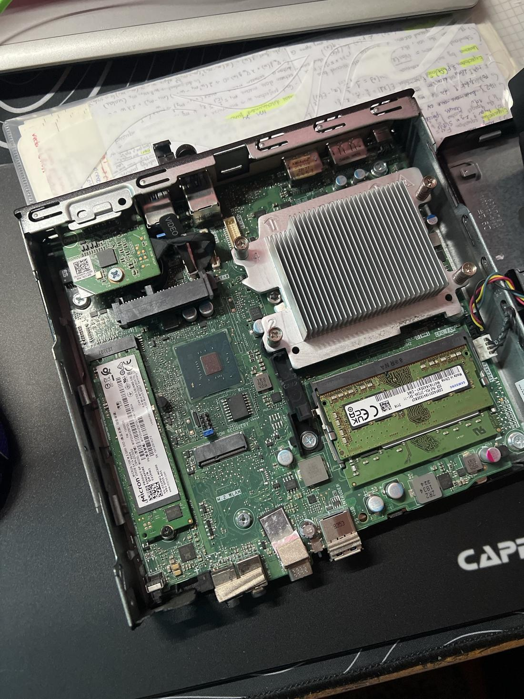
*Both SODIMM slots populated (top right), the M.2 SATA boot SSD (left), the empty M.2 Wi-Fi slot (bottom middle) and the 2.5" SATA connector (top left).*

**Rack (parts ordered, assembly pending):** a Tecmojo 10" 6U steel desktop rack (€89.90) and a TP-Link **TL-SG108E** managed switch (~€30). The switch will replace the unmanaged TP-Link LS1005G at the desk, so every wired device gets VLAN and port-mirroring support. A 3D-printed PETG rack was cheaper per part, but once mounts and shipping were added it cost almost the same, so steel won for the five-year horizon. A PDU, patch panel and extra shelves were each considered and dropped: there are only one or two cables in the rack.

**Total:** ≈ **€258** for the node, rack and switch.

## Validation before trusting it

A used machine is only cheap if it works. Everything was checked before anything was installed on it.

**Specs:** Windows (still on the drive from the seller) confirmed the i5-8500T, **16.0 GB with 2 of 2 slots in use at 2666 MT/s**, and UHD Graphics 630.

**SSD health (CrystalDiskInfo):** Health **Good**, 38 °C, **3,958 GB written** in total, which is a small fraction of the drive's rated endurance. Reallocated blocks, uncorrectable errors and UDMA CRC errors were all **0**.

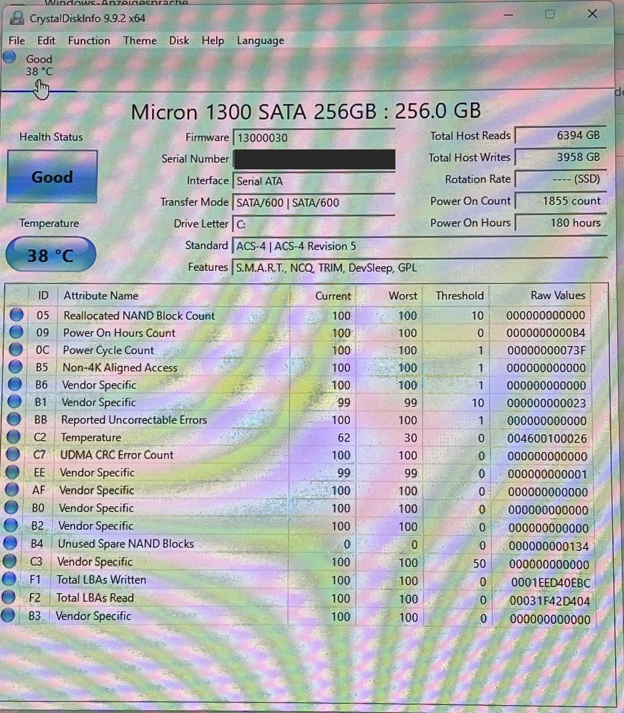
*Serial number masked.*

Two values looked alarming at first and turned out not to be:
- **Power-on hours: 180 against 1,855 power cycles.** That ratio is implausible for an office PC switched on every workday, so this counter doesn't reflect real usage on this drive. The written-bytes total is the more trustworthy wear indicator.
- **Attribute B4 "Unused Spare NAND Blocks": normalized value 0, threshold 0.** This is a Micron reporting quirk. The real figure is the raw value, `0x134` = 308 spare blocks, and the overall status is still Good.

**RAM (MemTest86+ v8.10, booted from Ventoy):** **1 full pass, 0 errors**, in 19 min 33 s, with both slots tested. This mattered: one stick had been sitting loose in a parts box with no anti-static bag. CPU temperature under the test was 58–61 °C.

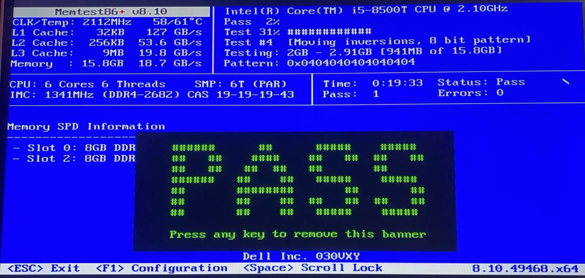

**A clue in the BIOS:** the boot list still had an entry for a *KIOXIA NVMe* drive that isn't installed. The seller had swapped the original drive at some point. It's harmless, but worth knowing on a used machine.

## BIOS preparation

| Setting | Value | Why |
|---|---|---|
| SATA Operation | **AHCI** | Already set. Dell often ships "RAID On", which Linux installers may not see |
| Virtualization (VT-x) | **On** | Required for VMs (Home Assistant OS) |
| VT for Direct I/O (VT-d) | **On** | Lets hardware be passed through to a VM later (e.g. the iGPU) |
| Secure Boot | **Off** | Avoids Ventoy and installer boot issues |
| AC Recovery | **Power On** | Boots on its own after a power cut |
| Deep Sleep Control | **Disabled** | Needed for Wake-on-LAN |
| Wake on LAN/WLAN | **LAN Only** | Remote wake |
| C-States | **On** | Low idle power |
| Boot mode | **UEFI** | |

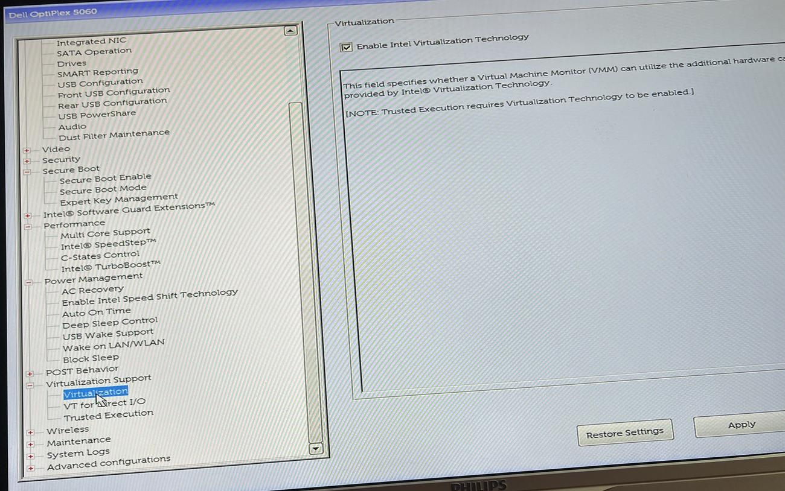

## Proxmox VE install

**Why Proxmox rather than TrueNAS again:** this node's job is running apps and VMs, not managing storage. Home Assistant OS needs a real VM to keep its add-ons, and one SSD gives TrueNAS nothing to do. The alternatives (plain Debian + Docker, CasaOS, Unraid) each lost on at least one of: full Home Assistant OS, one-click backup and restore for the eventual site consolidation, or licence cost.

- **ISO:** Proxmox VE 9.3-1, with the SHA256 checked against the download page using Ventoy's built-in checksum before booting it.
- **Filesystem: ext4 (LVM-thin), not ZFS.** With one disk, ZFS gives no redundancy. It would take part of the 16 GB that the VMs need for its cache, and it writes more to a consumer SATA SSD. The ZFS benefit that matters here, `zfs send` replication from the Vietnam pool, will come from a separate backup disk in the 2.5" bay instead.
- **Network:** hostname `pve-de.home.arpa` (`home.arpa` is the reserved domain for home networks), static `192.168.0.158/24`. The same address is also **reserved in the router against the node's MAC**, so DHCP can never hand it to another device. The German LAN (`192.168.0.0/24`) and the Vietnamese LAN (`192.168.1.0/24`) don't overlap, which keeps subnet routing between the sites possible.

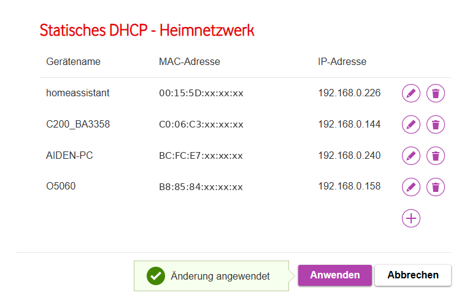
*Static lease on the Vodafone router. MAC addresses are masked to the vendor prefix.*

**Result:** Proxmox VE 9.3.1, kernel 7.0.14-30-pve, EFI boot, 15.4 GiB RAM visible, ~208 GiB of storage split between `local` (ISOs, backups) and `local-lvm` (guest disks), 8 GiB swap. Idle load is 0.03.

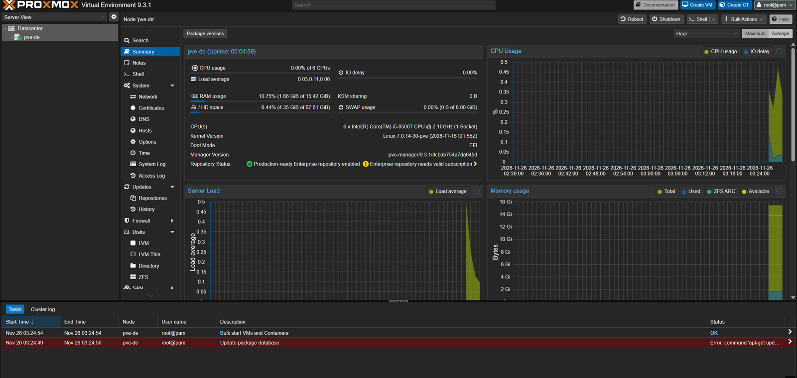

### Problem: the first update failed

The very first package update ended in a red `apt-get update` error. Proxmox enables its **enterprise repository** by default, and that repository refuses clients without a subscription. The **Ceph enterprise** repository was enabled too, although Ceph is for multi-node storage clusters and has no role on a single node.

**Fix:** disabled both enterprise repositories and added `pve-no-subscription`. The resulting "not recommended for production" warning is expected for a homelab.

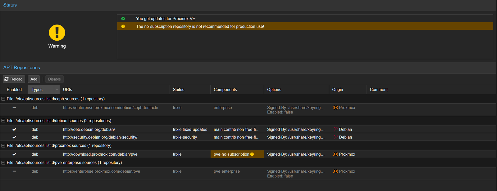

The upgrade then pulled 7 packages. One of them, `sg3-utils-udev`, warned that the boot disk's udev identification was stale until the next reboot. A reboot cleared that and also served as the first test that the node boots cleanly **without the USB stick**. Afterwards: **"No updates available."**

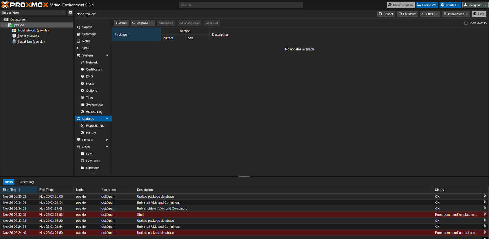

## Remote access: Tailscale on the host

Installed with Tailscale's official install script on the Proxmox host and joined to the same tailnet as the NAS and my client devices.

- **`tag:server`** on both servers, so a future ACL can treat "servers" as one group.
- **Key expiry disabled** on both servers. A headless node whose key expires silently drops off the tailnet. Personal devices **keep** expiry on: re-logging in on a phone takes seconds, and an expiring key limits how long a stolen device stays inside the network.
- **Not shared.** The NAS is shared with friends for the game server and Jellyfin. The Proxmox host controls every guest on it and is never shared.

**Finding:** while checking this, the NAS turned out to have its key expiring in **two months**, despite carrying `tag:server`. I had assumed the tag implied no expiry; the machine page showed otherwise. Had it expired, the NAS would have dropped off the tailnet with nobody on site to log it back in. Fixed by disabling expiry explicitly on that machine as well.

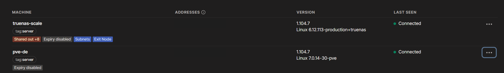
*Tailscale addresses masked.*

**Verified from outside the LAN:** the Proxmox web UI loaded on a phone over **5G**, with Wi-Fi off, through Tailscale.

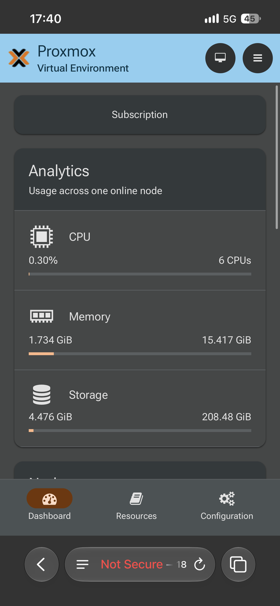

## Login hardening

Before the node was reachable from anywhere, `root@pam` got **TOTP two-factor plus one-time recovery keys** (stored in the password manager). It was tested in a private browser window while the existing session stayed open as a fallback. 2FA covers the web UI only; the physical console with the root password stays available as a last resort.

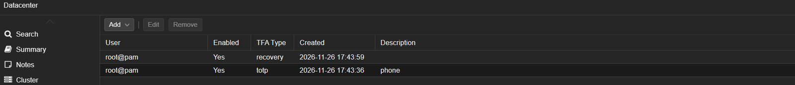

## Cross-site link test: Vodafone → VNPT

The [game server module](game-server-minecraft.md) found 6–10 % packet loss on the route German consumer ISPs (Telekom, O2) take to the NAS. The Germany node sits on a third ISP, Vodafone cable, so I measured that route before planning anything that depends on it.

```
root@pve-de:~# tailscale ping -c 5 truenas-scale
pong from truenas-scale (<tailscale-ip>) via DERP(sin) in 647ms
pong from truenas-scale (<tailscale-ip>) via DERP(sin) in 239ms
pong from truenas-scale (<tailscale-ip>) via DERP(sin) in 229ms
pong from truenas-scale (<tailscale-ip>) via DERP(sin) in 235ms
pong from truenas-scale (<tailscale-ip>) via 113.173.x.x:41292 in 273ms

root@pve-de:~# ping -c 100 -i 0.2 <truenas-scale tailscale-ip>
--- ping statistics ---
100 packets transmitted, 100 received, 0% packet loss, time 19939ms
rtt min/avg/max/mdev = 225.169/288.330/542.996/46.335 ms
```

| German access line | Loss to the NAS |
|---|---|
| Telekom (fixed line, earlier flat) | ~6 % |
| O2 / ALDI TALK (mobile) | ~10 % |
| **Vodafone cable (this node)** | **0 %** |

The first pings ran through Tailscale's **Singapore relay** while both ends negotiated, then switched to a **direct peer-to-peer** path to the VNPT line. A typical round trip of ~275 ms is the distance itself, and there were a handful of spikes to ~540 ms.

**What it means:** the cross-site backups and media cache this node is meant for don't need the data-center VPN workaround the game server needed. It's **one sample**, though, and this route has varied from day to day before ([Media Streaming](media-jellyfin.md)), so it gets re-measured at different times before anything relies on it.

## Decisions made along the way

| Decision | Reasoning |
|---|---|
| Minecraft **stays in Vietnam** | Per core, the i5-8500T is roughly level with the planned i7-4790, and RAM here is shared with the smart-home stack. The players are split 3 Europe / 2 Vietnam. Revisit if the Vodafone route stays clean. |
| No Frigate in Germany for now | It was already retired once on the NAS for costing more than it gave. It comes back only if presence detection becomes a real requirement. |
| Uptime Kuma in Germany, Grafana stays on the NAS | Different questions: "is it up?" vs. "how is it doing?". The up/down watcher has to live on the *other* site to be useful. |
| Small game servers (Valheim, Terraria…) possible later | As LXC containers started on demand. Palworld and Ark are ruled out by RAM. |
| No extra nodes | Two sites in two countries already give the redundancy a third box in the same room would. The upgrade order is RAM, then the 2.5" SSD, and only then new hardware. |

## Lessons learned

- **A used machine is a set of claims until tested.** The listing was accurate, but CrystalDiskInfo, MemTest and a stale boot entry each said something the listing didn't.
- **Read SMART values in context.** Two of the scariest-looking numbers (a normalized 0, an impossible hours/cycles ratio) were vendor quirks. The boring raw values were the meaningful ones.
- **An assumption about a security default is worth one click to verify.** "Tagged devices don't expire" was wrong for the NAS, and nothing would have shown it until the day it went offline 9,000 km away.
- **Measure each access network separately.** Two German ISPs lost 6–10 % to the NAS; the third loses nothing. A conclusion drawn from one line doesn't transfer to the next.

## Status and next steps

| Item | Status |
|---|---|
| Node validated, installed, updated, reboot-tested | ✅ Done |
| Fixed IP + router reservation | ✅ Done |
| Tailscale, tag, key expiry (incl. the NAS fix) | ✅ Done |
| 2FA + recovery keys | ✅ Done |
| Vodafone → VNPT link test | ✅ Done (one sample; re-test pending) |
| Rack + TL-SG108E assembly | ⏳ Parts ordered |
| Uptime Kuma (first LXC service) | ⏳ Next |
| Home Assistant migration from a Hyper-V VM on the desktop | ⏳ Planned |
| Cross-site backups (2.5" SSD as a ZFS backup target) | ⏳ Planned |
