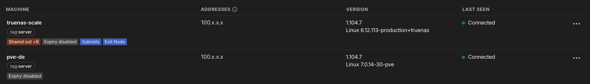
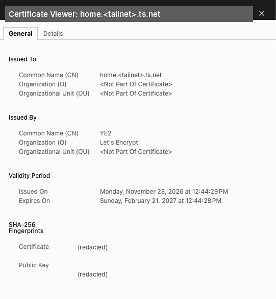
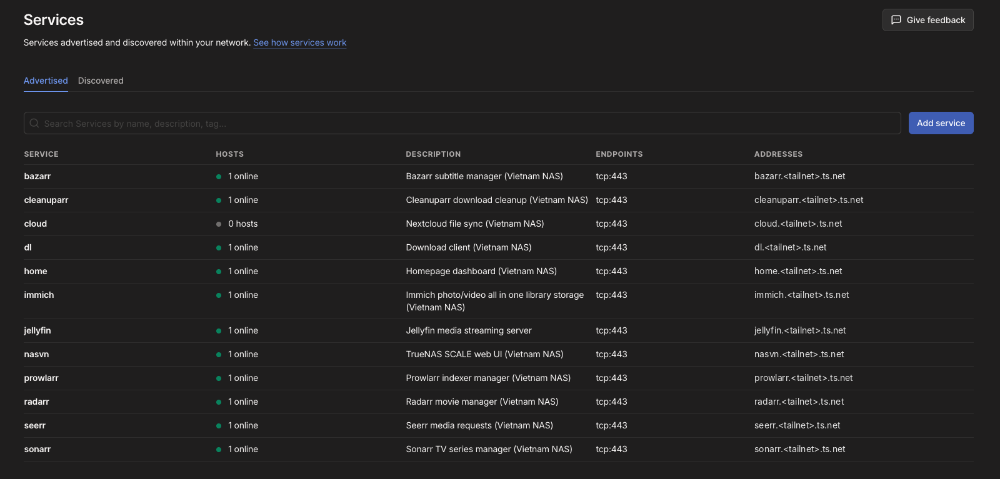

# Service Naming — Tailscale Services

*Part of the [self-hosted-homelab](../README.md) project.*

---

**Goal:** give every web service a memorable HTTPS name instead of `http://<nas-tailscale-ip>:<port>`, without opening a port, exposing anything to the internet, or paying for anything.

Before this module every service was reached as `http://100.x.x.x:30013`, `:30041`, `:30093` and so on. Nothing had HTTPS, nothing had a name, and the ports were whatever TrueNAS assigned. That was tolerable for one box, but two things forced a decision:

- **Vaultwarden is coming, and it needs HTTPS plus a stable URL.** Its `DOMAIN` setting and any passkeys / FIDO2 2FA registered against it are bound to that URL. Changing the URL later means reconfiguring every client and re-registering every credential, so the naming scheme has to be settled *before* Vaultwarden is deployed.
- **A second site now exists.** Names tied to a machine (`<host>:<port>`) break when a service moves between the Vietnam NAS and the Germany node, and some will.

> Addresses in this doc use `<tailnet>` for the tailnet DNS name and `100.x.x.x` for Tailscale IPs, per the repo's redaction rules.

## Options considered

All three keep the Tailscale-only stance.

| | A. `tailscale serve` on the host | **B. Tailscale Services** | C. Own domain + reverse proxy |
|---|---|---|---|
| URL | `https://<host>.<tailnet>.ts.net:<port>` | `https://<service>.<tailnet>.ts.net` | `https://<service>.home.<domain>` |
| Cost | Free | **Free** | ~€10/year for the domain |
| Survives moving a service to another host | No | **Yes** — the name belongs to the service, not the machine | Yes (change one DNS record) |
| Survives leaving Tailscale / changing the tailnet name | No | **No** | Yes |
| Extra moving parts | None | None (built into `tailscaled`) | Caddy/NPM, DNS-01 token, split DNS |
| Names in public certificate-transparency logs | Host names | Every service name | None, with a wildcard cert |

A per-service Tailscale *sidecar container* (one tailnet node per service, each with its own hostname) was the original version of B. **Tailscale Services** (public beta) makes it unnecessary: one host advertises many named services, each with its own virtual IP and MagicDNS name, and a service can later be drained from one host and advertised from another without its URL changing.

**Chosen: B.** Zero cost was the deciding constraint, and B gives host-independent names with no extra software.

**Accepted risk, recorded deliberately:** every URL — including Vaultwarden's `DOMAIN` — is bound to the tailnet name and to Tailscale itself. Leaving Tailscale or renaming the tailnet would mean repointing clients and re-registering passkeys once. Option C remains available later (e.g. for a public demo) without disturbing anything built here.

Rejected along the way: buying a domain only to personalise URLs (it would not make anything reachable to people outside the tailnet), and DuckDNS as a free option C (volunteer-run with a history of outages — not something a password manager should depend on).

## Step 1 — Tailnet name, MagicDNS, HTTPS

- **Tailnet DNS name:** the default `tailXXXXXX.ts.net` was swapped for a generated "fun name" (`word-word.ts.net`). Names can't be typed freely, only picked from re-rollable generated options.
- **Order matters:** the fun name can be changed freely *until the first HTTPS certificate is issued against it*. After that it is bound to the account and can only revert to the default. So the name was picked first and treated as permanent.
- **MagicDNS** was already on; **HTTPS Certificates** enabled.
- Renaming changes every existing MagicDNS name (`truenas-scale.<old>.ts.net`). Anything using raw `100.x` IPs is unaffected.

## Step 2 — Policy: a server tag and auto-approvers

The default policy (one allow-all grant + the default SSH rule) was extended, not replaced:

```jsonc
"tagOwners": {
	"tag:server": ["autogroup:admin"],
},

"autoApprovers": {
	"routes":   { "192.168.1.0/24": ["tag:server"] },
	"exitNode": ["tag:server"],
	"services": {
		"svc:jellyfin": ["tag:server"],
		"svc:seerr":    ["tag:server"],
		// … one line per service
	},
},
```

`routes` and `exitNode` were added as a safety net: tagging a node changes its ownership, and these keep the NAS's subnet router and exit node approved through that change.

## Step 3 — Tagging a node that carries 8 shares

Hosting a Service requires a **tagged** node. The NAS was user-owned and carried **8 outgoing node shares** (friends using Minecraft and Jellyfin), the subnet route and the exit node. Tailscale's docs are inconsistent on whether shares survive tagging, and a forum report described having to remove tags and re-authenticate to restore a share.

Preparation before tagging: share list captured as a re-share checklist, auto-approvers for route/exit node saved, friends warned, read-only checks on the Tailscale container (`v1.104.7`, `host` network mode, `/var/lib/tailscale` on a persistent volume, no existing serve config).

**Result:** tagged via *Machines → … → Edit ACL tags*. `Shared out +8`, `Subnets` and `Exit Node` all remained, no re-approval was needed, and — the test that actually matters, since it can't be run from inside your own tailnet — **a friend joined the Minecraft server afterwards without issue.**


*After tagging: `tag:server`, key expiry disabled, and `Shared out +8`, `Subnets` and `Exit Node` all still present. The Germany node (`pve-de`) carries the same tag. IPs redacted.*

Shared users still reach the NAS by its node address, not by Service names: *a machine cannot be shared with a tag, and Services aren't visible across a share*. Friends' links and Wizarr invites therefore stay on the original address.

## Step 4 — Define, serve, verify

For each service: define it in *Services → Add service* (name, description, endpoint `tcp:443`), then point the NAS at it. TrueNAS's Tailscale app runs in `host` network mode, so every target is `127.0.0.1:<published port>`:

```bash
ts() { sudo docker exec ix-tailscale-tailscale-1 tailscale serve --https=443 --bg --yes "$@"; }
ts --service=svc:jellyfin   http://127.0.0.1:30013
ts --service=svc:immich     http://127.0.0.1:30041
ts --service=svc:seerr      http://127.0.0.1:30093
ts --service=svc:sonarr     http://127.0.0.1:30090
ts --service=svc:radarr     http://127.0.0.1:30091
ts --service=svc:prowlarr   http://127.0.0.1:30089
ts --service=svc:bazarr     http://127.0.0.1:30092
ts --service=svc:cleanuparr http://127.0.0.1:30096
ts --service=svc:home       http://127.0.0.1:30095
ts --service=svc:dl         http://127.0.0.1:30080
ts --service=svc:nasvn      https+insecure://127.0.0.1:443   # TrueNAS UI, self-signed upstream
```

Every command prints *"approval from an admin is required"* — that message is printed before the auto-approver applies and can be ignored; the Hosts tab is the ground truth. The first load of each name takes up to a minute while its Let's Encrypt certificate is issued; afterwards it's instant. Verified on the first service: certificate CN `seerr.<tailnet>.ts.net`, issuer Let's Encrypt, 90-day validity renewed automatically.


*Each Service name gets its own Let's Encrypt certificate, valid 90 days and renewed by Tailscale. Tailnet name and fingerprints redacted.*

**Persistence verified:** the Tailscale app was restarted and the serve config came back untouched — it lives in `/var/lib/tailscale` on a mounted volume.

### Services now served

| Service | Name | Upstream | Notes |
|---|---|---|---|
| Jellyfin | `jellyfin` | `:30013` | Friends keep using the node address |
| Immich | `immich` | `:30041` | |
| Seerr | `seerr` | `:30093` | First service, used as the pilot |
| Sonarr / Radarr / Prowlarr | `sonarr` / `radarr` / `prowlarr` | `:30090` / `:30091` / `:30089` | |
| Bazarr | `bazarr` | `:30092` | Had no authentication at all — fixed (below) |
| Cleanuparr | `cleanuparr` | `:30096` | |
| Homepage | `home` | `:30095` | Needed `HOMEPAGE_ALLOWED_HOSTS` |
| Download client | `dl` | `:30080` | Auth settings hardened first |
| TrueNAS UI | `nasvn` | `https+insecure://…:443` | Replaces a LAN-only link with a cert warning |


*Every served service reports one healthy host; `cloud` is defined but not served yet. Tailnet name redacted.*

**Kept on the node address on purpose:** Wizarr (invite links are built from whatever address you open it on, and friends can't reach Services), Minecraft (not HTTP), Prometheus (no login; Grafana is the front end). **Pending:** Nextcloud (`cloud`, needs `trusted_domains` + `overwriteprotocol`), Lidarr (paused), Grafana (stopped), and the Germany node's Vaultwarden / Uptime Kuma / Home Assistant.

Service names were chosen knowing they appear in public certificate-transparency logs — hence `dl` rather than the download client's name, and `nasvn` rather than anything identifying.

## Per-app adjustments

**Homepage** rejects unknown `Host` headers. The new name was appended to the existing list in the app's compose YAML (no port — 443 is implicit):

```yaml
HOMEPAGE_ALLOWED_HOSTS: <ip>:30095,192.168.1.4:30095,localhost:30095,home.<tailnet>.ts.net
```

The dashboard's tile **`href:`** links were then rewritten to the new names with a backed-up, `href:`-scoped `sed`. Widget **`url:`** fields were deliberately left on internal addresses: they're fetched by the Homepage container, which doesn't use the tailnet's DNS, and the internal path is faster anyway.

**Download client:** *Bypass authentication for clients on localhost* off, the subnet-whitelist bypass off and empty, and the failed-login ban lowered from 9999 to 5. Host-header validation was already `*`, CSRF protection stayed on.

## Finding: a proxy on localhost turns "local" auth bypasses into real ones

`tailscale serve` forwards to `127.0.0.1`, so **every request reaches the app from localhost** regardless of who sent it. Any "skip login for local clients" setting now applies to everyone on the tailnet.

Checked by opening each name in a private window:

| App | Result |
|---|---|
| Sonarr, Radarr, Prowlarr, Cleanuparr | Login enforced ✅ |
| Bazarr | **Opened straight into the UI** — authentication had never been configured. Set to Forms auth |
| Download client | Localhost bypass disabled *before* serving |

API keys used by Homepage widgets and app-to-app connections are unaffected by enabling web login.

## Runbook

```bash
# Inspect
sudo docker exec ix-tailscale-tailscale-1 tailscale serve status
sudo docker exec ix-tailscale-tailscale-1 tailscale serve get-config --all

# Stop serving one service / remove its config
sudo docker exec ix-tailscale-tailscale-1 tailscale serve --service=svc:<name> --https=443 off
sudo docker exec ix-tailscale-tailscale-1 tailscale serve clear svc:<name>
```

**Adding a service, in this order:**
1. Add `"svc:<name>": ["tag:server"]` to `autoApprovers.services` — *before* defining it. `nasvn` was defined while the policy still said `svc:nas` and needed a manual approval.
2. Define it in *Services* (`tcp:443`).
3. Check the app for host-name allow-lists and localhost auth bypasses.
4. `serve` it, confirm *1 online* on the Hosts tab.
5. Open it in a private window: valid certificate, login prompt.

## Known limitations

- Tailscale Services is in **public beta**; behaviour and plan limits may change. Fallback is a sidecar container per service, which keeps the same `<service>.<tailnet>.ts.net` URL pattern.
- URLs are bound to the tailnet name and to Tailscale (accepted risk above).
- Shared users can't use Service names — they stay on node addresses.
- Requests arrive at apps from `127.0.0.1`, so apps' logs lose the real client IP unless the proxy is configured as trusted (e.g. Jellyfin *Known proxies*). Cosmetic, not done.
- `tailscale serve` targets are only as persistent as `/var/lib/tailscale`; a rebuilt Tailscale app without that volume would lose them.

## Lessons

- **Settle names before anything depends on them.** The tailnet name becomes permanent at the first certificate, and Vaultwarden's URL is permanent at the first passkey. Both were decided before either happened.
- **When the docs are ambiguous, prepare a rollback and test the real case.** Tagging a node with 8 shares was a documented unknown; the answer came from a friend joining the server, not from the admin console still showing the badge.
- **Putting a proxy in front of an app changes who the app thinks is calling.** Any trust based on "the request came from localhost" silently extends to everyone the proxy serves.
- **A friendly URL makes an old gap worth fixing.** Bazarr had no login since it was set up; behind an unmemorable IP:port with no other tailnet users that was low-risk, but a clean HTTPS name is exactly what gets bookmarked and clicked.
